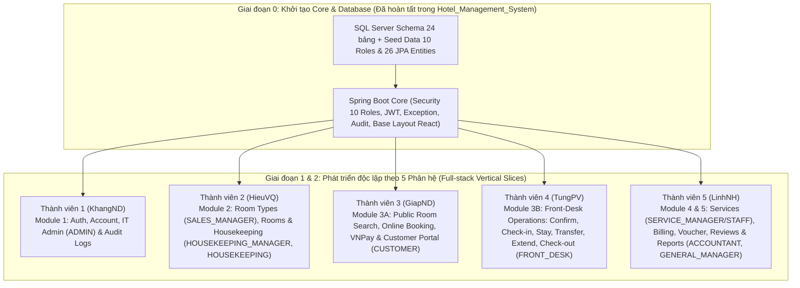

# Phân Tích Tài Liệu SRS & SDD và Chiến Lược Phân Chia Code Nhóm 5 Người (Dự Án HMS)

Tài liệu này tổng hợp kết quả phân tích chi tiết và cập nhật kiến trúc phân quyền **10 Roles chuyên biệt** (theo góp ý của Mentor) cho:
- [HMS_SoftwareRequirementSpecification.docx](./HMS_SoftwareRequirementSpecification.docx) (`HMS-SRS v1.3`)
- [HMS_SoftwareDesignDocument.docx](./HMS_SoftwareDesignDocument.docx) (`HMS_SDD v1.1`)

---

## 1. Tổng Quan Hệ Thống & Kiến Trúc Phân Quyền 10 Roles (Đã Tách Role Manager)

### 1.1 Giải quyết vấn đề "Overloaded Manager Role" theo góp ý của Mentor
Trước đây, role `Manager` bị gộp chung nhiệm vụ của nhiều phòng ban độc lập ngoài thực tế. Dựa trên cấu trúc phòng ban ở **Mục 1.1 của SRS**, hệ thống hiện được tách thành **10 User Roles (Actors con người)** rõ ràng, đảm bảo nguyên tắc **Separation of Duties (SoD)**:

| # | Mã Role (`RoleName` Enum) | Tên Actor trong SRS / SDD | Phòng ban tương ứng (Bảng `Department`) | Phạm vi nghiệp vụ & Use Cases được phép truy cập |
| :-: | :--- | :--- | :--- | :--- |
| 1 | `CUSTOMER` | **Customer** | *Khách hàng bên ngoài* | Đăng ký (`UC-01`), Tìm & Xem phòng (`UC-14, 21, 22`), Đặt phòng & Thanh toán VNPay (`UC-23`), Lịch sử & Hủy đặt phòng (`UC-24, 25`), Gọi dịch vụ phòng (`UC-34, 35`), Đánh giá sau lưu trú (`UC-41, 42`). |
| 2 | `FRONT_DESK` | **Front-Desk Staff** | *Front Office Department* | Xác nhận đặt phòng trực tiếp/chờ duyệt (`UC-26`), Check-in & gán phòng sạch (`UC-27`), Đổi phòng (`UC-28`), Gia hạn (`UC-29`), Check-out (`UC-30`), Lập hóa đơn Folio, áp Voucher, thu tiền & in biên lai (`UC-37..40`), Phản hồi đánh giá (`UC-43`). |
| 3 | `HOUSEKEEPING` | **Housekeeping Staff** | *Housekeeping Department* | Xem danh sách phòng & bảng phân công dọn phòng (`UC-18, 19`), Cập nhật tiến độ vệ sinh (`Dirty` → `Clean` → `Inspected` `UC-19`), Báo cáo hỏng hóc thiết bị (`UC-20`). |
| 4 | `SERVICE_STAFF` | **Service Staff** | *Services & Ancillary Division* | Xem danh mục dịch vụ (`UC-34`), Nhận và hoàn thành đơn dịch vụ phòng, ghi phí vào Folio (`UC-35`), Hủy dịch vụ chưa cung cấp (`UC-36`). |
| 5 | `SALES_MANAGER` | **Sales & Marketing Manager** | *Sales & Marketing Department* | Cấu hình hạng phòng (`UC-11..13`), Cấu hình bảng giá theo thứ (`Room_Type_Price`), Quản lý mã khuyến mãi (`Voucher`), Phản hồi và ẩn/hiện đánh giá khách hàng (`UC-43, 44`), Xem báo cáo công suất phòng (`UC-45`). |
| 6 | `HOUSEKEEPING_MANAGER` | **Housekeeping Manager** | *Housekeeping Department* | Quản lý danh sách phòng vật lý (`UC-15..18`), Phân công nhân viên dọn phòng (`UC-51`), Duyệt và khóa phòng bảo trì (`UC-20`). |
| 7 | `SERVICE_MANAGER` | **Service Manager** | *Services & Ancillary Division* | Tạo mới dịch vụ phụ trợ (`UC-31`), Cập nhật giá dịch vụ (`UC-32`), Ngừng cung cấp dịch vụ (`UC-33`), Phân tích sản lượng tiêu thụ dịch vụ (`UC-47`). |
| 8 | `ACCOUNTANT` | **Accountant** | *Accounting & Finance Department* | Đối soát hóa đơn Folio & thanh toán (`UC-37..40`), Xem báo cáo phân tích doanh thu (`UC-46`), Phân tích doanh thu dịch vụ (`UC-47`), Xuất báo cáo tổng hợp (`UC-50`). |
| 9 | `GENERAL_MANAGER` | **General Manager** | *Executive Management Board* | Giám sát toàn bộ chỉ số vận hành khách sạn: Báo cáo công suất (`UC-45`), Báo cáo doanh thu (`UC-46`), Báo cáo dịch vụ (`UC-47`), Xuất báo cáo tổng hợp (`UC-50`), Tra cứu Operational Audit Logs (`UC-49`). |
| 10 | `ADMIN` | **Administrator** | *IT & Technical Department* | Quản lý tài khoản người dùng (`UC-07`), Khóa/Mở khóa tài khoản & thu hồi token (`UC-08`), Gán Role cho nhân viên (`UC-09`), Cấu hình tham số Audit (`UC-48`) và kiểm tra Security Audit Logs (`UC-49`). |

*(Cùng 2 Actor hệ thống bên ngoài: **11. Payment Gateway - VNPay** và **12. Mail Notification Service - Google SMTP**).*

---

## 2. Kiến Trúc Kỹ Thuật & Quy Ước Chung (SDD v1.1)

- **Frontend (SPA)**: ReactJS 18 (Vite + Pure JavaScript / JSX `.js` & `.jsx`, Functional Components + Hooks — không dùng TypeScript/TSX để khớp 100% chương trình học trên trường), React Router DOM v6, React-Bootstrap + Bootstrap Icons, Axios.
- **Backend (3-Layer REST API)**: Java 21, Spring Boot 3.2.5, Spring Security 6 (Stateless JWT + `@PreAuthorize` theo 10 Roles), Spring Data JPA (Hibernate), Jakarta Validation, Springdoc-OpenAPI (Swagger 3).
- **Database**: Microsoft SQL Server 2019/2022 (**24 bảng nghiệp vụ chính** + 2 bảng hệ thống `Refresh_Token` & `System_Error_Log`).

---

## 3. Chiến Lược Phân Chia Công Việc Cho Nhóm 5 Người

Thiết kế của dự án chia thành **5 Subsystems** (tương ứng từ mục `4.2` đến `4.6` trong SDD và 5 nhóm Use Case trong SRS). Mỗi thành viên phụ trách **1 Phân hệ Full-stack (Vertical Slice)** từ Backend API đến React Page:



### Bảng phân công chi tiết cho 5 thành viên (Cân bằng khối lượng code ~20% mỗi người)

| Thành viên | Phân hệ phụ trách (Full-stack BE + FE) | Các Roles liên quan trực tiếp | Use Cases phụ trách | Bảng DB (Entities) chính sở hữu | Các màn hình (React Pages) chính |
| :--- | :--- | :--- | :--- | :--- | :--- |
| **Thành viên 1**<br/>*(KhangND - Team Lead)* | **Core Security + Module 1: Account, Auth, User Governance & Audit/System Logs** | `All Roles` (Auth), `ADMIN`, `GENERAL_MANAGER` (Audit) | `UC-01` → `UC-10`, `UC-48`, `UC-49`<br/>*(12 UCs + Core)* | `Role`, `Account`, `Customer`, `Staff`, `Department`, `Refresh_Token`, `Audit_Log`, `System_Error_Log` | • Login, Register, Forgot/Reset Password<br/>• User Profile, Change Password<br/>• Admin Dashboard, User Management (List, Detail, Toggle Status, Assign 10 Roles)<br/>• Audit Parameters, Security & Operational Audit Logs |
| **Thành viên 2**<br/>*(HieuVQ)* | **Module 2: Room Types, Physical Inventory, Housekeeping & Maintenance** | `SALES_MANAGER` (Room Type/Price), `HOUSEKEEPING_MANAGER`, `HOUSEKEEPING` | `UC-11` → `UC-13`, `UC-15` → `UC-20`, `UC-51`<br/>*(10 UCs)* | `Room_Type`, `Room_Type_Price`, `Room`, `Housekeeping_Task` | • `SALES_MANAGER`: Room Type CRUD & Pricing theo thứ<br/>• `HOUSEKEEPING_MANAGER`: Room Inventory CRUD & Assign Cleaning Tasks (`UC-51`)<br/>• `HOUSEKEEPING`: Housekeeping Board (`UC-19`), Room Status Details & Maintenance (`UC-20`) |
| **Thành viên 3**<br/>*(GiapND)* | **Module 3A: Public Catalog, Online Booking, VNPay & Customer Portal** | `CUSTOMER`, `FRONT_DESK` | `UC-14`, `UC-21` → `UC-25` + Scheduled Job 24h Hold (`BR-19`)<br/>*(6 UCs lớn + VNPay)* | `Reservation`, `Reservation_Detail`, `Reservation_Nightly_Rate`, `Payment` (Deposit), `Payment_Attempt` | • Public Landing Page, Room List & Search Available Rooms (`UC-14`, `UC-21`), Room Details (`UC-22`)<br/>• Booking Checkout (`UC-23`), Online Payment (VNPay Callback), Booking Confirmation<br/>• Customer: My Bookings, Find Booking, Cancel Booking (`UC-24`, `UC-25`) |
| **Thành viên 4**<br/>*(TungPV)* | **Module 3B: Front-Desk Operations & In-House Stay Management** | `FRONT_DESK` | `UC-26` → `UC-30`<br/>*(5 UCs nghiệp vụ phức tạp nhất)* | `Guest_Stay`, `Stay_Room_Assignment` *(phối hợp `Reservation`, `Room`, `Folio`)* | • Front-Desk Dashboard, Pending Reservations & Confirm Reservation (`UC-26`)<br/>• Direct Reservation Form<br/>• Arrivals List & Guest Check-in Form (`UC-27`)<br/>• Active Stay List & Details, Transfer Room (`UC-28`), Extend Stay (`UC-29`), Check-out (`UC-30`) |
| **Thành viên 5**<br/>*(LinhNH)* | **Module 4 & 5: Services, Folio Billing, Vouchers, Reviews & Analytics Reports** | `SERVICE_MANAGER`, `SERVICE_STAFF`, `SALES_MANAGER` (Voucher/Review), `ACCOUNTANT`, `GENERAL_MANAGER` | `UC-31` → `UC-40`, `UC-41` → `UC-47`, `UC-50`<br/>*(18 UCs)* | `Hotel_Service`, `Service_Order`, `Folio`, `Additional_Charge`, `Voucher`, `Invoice`, `Review` | • `SERVICE_MANAGER`: Services Catalog CRUD (`UC-31..33`)<br/>• `SERVICE_STAFF`: Order & Void Service (`UC-34..36`)<br/>• `FRONT_DESK` / `ACCOUNTANT`: Check-out & Billing, Apply Voucher, Payment, Printable Invoice (`UC-37..40`)<br/>• `SALES_MANAGER`: Voucher CRUD & Review Moderation/Reply (`UC-41..44`)<br/>• `GENERAL_MANAGER` / `ACCOUNTANT`: Reports Dashboard (`UC-45..47, 50`) |

---

## 4. Tổ Chức Cấu Trúc Thư Mục Để Không Đụng Hàng (Merge Conflict)

```text
Hotel_Management_System/
├── .github/
│   └── pull_request_template.md
├── database/
│   ├── V1__init_schema.sql          # 24 bảng nghiệp vụ + 2 bảng hệ thống
│   └── V2__seed_master_data.sql     # Dữ liệu mẫu (10 Roles chuyên biệt, 10 Accounts mẫu, 7 Departments, Rooms, Services, Vouchers)
├── backend/                         # Spring Boot 3 (Java 21)
│   └── src/main/java/com/fpt/hms/
│       ├── config/                  # CORS, OpenAPI, Clock, SecurityConfig
│       ├── security/                # JwtAuthFilter, JwtTokenProvider, UserPrincipal
│       ├── exception/               # GlobalExceptionHandler, BusinessException
│       ├── common/                  # PageResponse, MessageResolver, AuditService, TraceIdFilter
│       ├── enums/                   # RoleName (10 Roles), RoomStatus, CleaningStatus, ReservationStatus...
│       ├── entity/                  # 26 JPA Entities
│       ├── repository/              # 26 Spring Data JPA Repositories
│       ├── dto/
│       │   ├── auth/                # TV1 (KhangND)
│       │   ├── room/                # TV2 (HieuVQ)
│       │   ├── booking/             # TV3 (GiapND)
│       │   ├── frontdesk/           # TV4 (TungPV)
│       │   └── billing_report/      # TV5 (LinhNH)
│       ├── controller/              # Tách riêng theo từng phân hệ
│       ├── service/
│       └── service/impl/
└── frontend/                        # ReactJS 18 (Vite + Pure JavaScript / JSX)
    └── src/
        ├── config/                  # constants.js (10 Roles)
        ├── lib/                     # http.js, datetime.js, money.js
        ├── context/                 # AuthContext.jsx
        ├── components/common/       # RoleGuard.jsx, StatusBadge.jsx, DataTable.jsx, ProtectedRoute.jsx, ToastHost.jsx, ErrorBoundary.jsx
        ├── layouts/                 # CustomerLayout.jsx, StaffLayout.jsx (Sidebar lọc theo đúng 10 Roles)
        ├── router/                  # 5 file route độc lập (.jsx: authRoutes, roomRoutes, bookingRoutes, frontDeskRoutes, billingRoutes)
        ├── services/                # 5 file API độc lập (.js: authApi, roomApi, bookingApi, frontDeskApi, billingApi)
        └── pages/                   # Chia thư mục riêng (.jsx) cho từng thành viên
```

---

## 5. Danh Mục Chi Tiết Toàn Bộ 51 Use Cases (SRS Mục 2.2.2)

Hệ thống HMS bao gồm tổng cộng **51 Use Cases** (`UC-01` đến `UC-51`), được phân bổ vào **5 phân hệ chức năng**:
- **Quy ước ký hiệu Role:**
  - **`All Users`**: Áp dụng cho toàn bộ 10 role người dùng (`Customer`, `Front-Desk Staff`, `Housekeeping Staff`, `Service Staff`, `Sales & Marketing Manager`, `Housekeeping Manager`, `Service Manager`, `Accountant`, `General Manager`, `Administrator`).
  - **Tác nhân hệ thống bên ngoài**: *Payment Gateway (VNPay)* và *Mail Notification Service (Google SMTP)*.

### 5.1 Phân hệ 1: Quản lý Tài khoản & Xác thực (`UC-01` – `UC-10`)

| Mã UC | Tên Use Case | Role thực hiện | Mô tả | Main Flow (Luồng chính) |
| :--- | :--- | :--- | :--- | :--- |
| `UC-01` | Đăng ký khách hàng (*Register Customer*) | `Customer` (Khách chưa đăng nhập) | Cho phép khách vãng lai tạo tài khoản khách hàng cá nhân. | (1) Mở trang đăng ký → (2) Nhập họ tên, email, SĐT, mật khẩu → (3) Hệ thống kiểm tra định dạng và tính duy nhất của email → (4) Tạo tài khoản Customer và hiển thị xác nhận. |
| `UC-02` | Đăng nhập (*Log In*) | `All Users` | Xác thực thông tin đăng nhập để cấp quyền truy cập các phân hệ. | (1) Nhập email và mật khẩu → (2) Hệ thống kiểm tra thông tin và xác nhận tài khoản đang `Active` → (3) Khởi tạo phiên đăng nhập và điều hướng về Dashboard theo role. |
| `UC-03` | Xem hồ sơ cá nhân (*View Profile*) | `All Users` | Hiển thị thông tin tài khoản của người dùng đang đăng nhập. | (1) Mở trang hồ sơ cá nhân → (2) Hệ thống truy xuất thông tin từ phiên hiện tại → (3) Hiển thị họ tên, email, SĐT và role được gán. |
| `UC-04` | Cập nhật hồ sơ (*Update Profile*) | `All Users` | Chỉnh sửa thông tin liên hệ cá nhân của người dùng. | (1) Sửa họ tên hoặc SĐT trên trang hồ sơ → (2) Xác nhận lưu → (3) Hệ thống kiểm tra định dạng SĐT và lưu thay đổi → (4) Thông báo cập nhật thành công. |
| `UC-05` | Đổi mật khẩu (*Change Password*) | `All Users` | Cập nhật mật khẩu tài khoản để đảm bảo bảo mật. | (1) Nhập mật khẩu hiện tại, mật khẩu mới và xác nhận mật khẩu → (2) Hệ thống kiểm tra mật khẩu hiện tại → (3) Kiểm tra độ mạnh mật khẩu mới → (4) Lưu mật khẩu mới và báo thành công. |
| `UC-06` | Đăng xuất (*Log Out*) | `All Users` | Kết thúc phiên làm việc đã xác thực hiện tại. | (1) Người dùng chọn lệnh đăng xuất → (2) Hệ thống xóa phiên xác thực hiện hành → (3) Điều hướng người dùng về trang chủ công khai. |
| `UC-07` | Quản lý tài khoản (*Manage User Accounts*) | `Administrator` | Tra cứu, tìm kiếm và lọc toàn bộ tài khoản người dùng. | (1) Admin mở màn hình quản trị người dùng → (2) Hệ thống tải danh sách tài khoản kèm bộ lọc → (3) Admin lọc theo tên, role hoặc trạng thái → (4) Hệ thống cập nhật bảng kết quả khớp điều kiện. |
| `UC-08` | Đổi trạng thái tài khoản (*Toggle User Account Status*) | `Administrator` | Kích hoạt hoặc vô hiệu hóa tài khoản để kiểm soát quyền truy cập. | (1) Admin chọn tài khoản mục tiêu → (2) Chuyển trạng thái (`Active` / `Inactive`) → (3) Hệ thống kiểm tra Admin không tự khóa chính mình → (4) Lưu trạng thái và thu hồi ngay các token đang hoạt động nếu khóa. |
| `UC-09` | Phân quyền người dùng (*Assign User Roles*) | `Administrator` | Cập nhật vai trò phân quyền cho tài khoản nhân sự. | (1) Admin chọn tài khoản nhân viên → (2) Chọn role mới trong 9 role nội bộ → (3) Hệ thống kiểm tra thẩm quyền, lưu role mới và ghi Audit Log → (4) Hiển thị thông báo xác nhận. |
| `UC-10` | Đặt lại mật khẩu (*Reset Password*) | `All Users`, *Mail Notification Service* | Khôi phục quyền truy cập tài khoản qua email xác thực có thời hạn. | (1) Nhập email đã đăng ký ở màn hình quên mật khẩu → (2) Hệ thống kiểm tra email và tạo mã/token có thời hạn → (3) Gửi email khôi phục qua Mail Service → (4) Người dùng xác thực mã, nhập mật khẩu mới và hệ thống cập nhật. |

### 5.2 Phân hệ 2: Quản lý Phòng & Cơ sở vật chất (`UC-11` – `UC-20` & `UC-51`)

| Mã UC | Tên Use Case | Role thực hiện | Mô tả | Main Flow (Luồng chính) |
| :--- | :--- | :--- | :--- | :--- |
| `UC-11` | Tạo hạng phòng (*Create Room Type*) | `Sales & Marketing Manager` | Cấu hình một hạng phòng lưu trú mới (VD: Deluxe, Suite). | (1) Mở form tạo hạng phòng → (2) Nhập tên hạng phòng, giá chuẩn, sức chứa và tiện nghi → (3) Hệ thống kiểm tra trùng tên và giá dương → (4) Lưu hạng phòng vào danh mục đang hoạt động. |
| `UC-12` | Cập nhật hạng phòng (*Update Room Type Details*) | `Sales & Marketing Manager` | Điều chỉnh giá, sức chứa hoặc mô tả của hạng phòng hiện có. | (1) Chọn hạng phòng cần sửa → (2) Chỉnh sửa giá đêm cơ bản, sức chứa hoặc tiện nghi → (3) Hệ thống kiểm tra dữ liệu và cập nhật bản ghi → (4) Thông báo cập nhật thành công. |
| `UC-13` | Ngừng kích hoạt hạng phòng (*Deactivate Room Category*) | `Sales & Marketing Manager` | Ngừng cung cấp một hạng phòng khỏi danh mục kinh doanh. | (1) Chọn hạng phòng cần ngừng hoạt động → (2) Hệ thống kiểm tra không còn phòng vật lý đang hoạt động thuộc hạng này → (3) Chuyển trạng thái sang `Inactive`, chặn đặt mới nhưng giữ lịch sử. |
| `UC-14` | Xem danh mục hạng phòng (*View Room Categories*) | `Customer`, `Front-Desk Staff`, `Sales & Marketing Manager` | Hiển thị danh mục công khai các hạng phòng và thông tin mô tả. | (1) Truy cập màn hình danh mục hạng phòng → (2) Hệ thống lấy toàn bộ hạng phòng đang hoạt động → (3) Hiển thị thẻ hạng phòng gồm ảnh, mô tả, sức chứa và giá chuẩn. |
| `UC-15` | Tạo phòng vật lý (*Create Room*) | `Housekeeping Manager` | Đăng ký một phòng vật lý cụ thể vào kho phòng khách sạn. | (1) Nhập số phòng, tầng và chọn hạng phòng → (2) Hệ thống kiểm tra số phòng không trùng lặp → (3) Lưu phòng mới với trạng thái trống (`Vacant`) và sạch (`Clean`). |
| `UC-16` | Cập nhật thông tin phòng (*Update Room Details*) | `Housekeeping Manager` | Sửa thuộc tính phòng vật lý, vị trí tầng hoặc ghi chú. | (1) Chọn hồ sơ phòng cần sửa → (2) Cập nhật tầng, hạng phòng liên kết hoặc ghi chú → (3) Hệ thống lưu thay đổi và làm mới bảng danh sách phòng. |
| `UC-17` | Lưu trữ phòng (*Archive Room*) | `Housekeeping Manager` | Đưa phòng không còn khai thác ra khỏi kho vận hành. | (1) Chọn phòng cần lưu trữ → (2) Hệ thống kiểm tra phòng đang trống và không có lịch đặt hiện tại/tương lai → (3) Đánh dấu `Archived` và loại khỏi lịch phân bổ. |
| `UC-18` | Xem tồn kho phòng (*View Room Inventory*) | `Front-Desk Staff`, `Housekeeping Staff`, `Housekeeping Manager`, `General Manager` | Hiển thị bảng vận hành toàn bộ phòng kèm bộ lọc đa trạng thái. | (1) Mở bảng quản lý kho phòng → (2) Lọc theo tầng, hạng phòng, trạng thái có khách hoặc độ sạch → (3) Hệ thống truy xuất và hiển thị danh sách phòng tương ứng. |
| `UC-19` | Cập nhật trạng thái dọn phòng (*Update Housekeeping Status*) | `Housekeeping Staff`, `Housekeeping Manager` | Cập nhật tiến độ vệ sinh phòng từ Bẩn (`Dirty`) sang Sạch (`Clean`). | (1) Mở bảng công việc buồng phòng → (2) Chọn phòng `Dirty` đã được vệ sinh xong → (3) Đổi trạng thái sang `Clean` → (4) Hệ thống cập nhật trạng thái sẵn sàng đón khách cho lễ tân. |
| `UC-20` | Thiết lập bảo trì phòng (*Set Room Maintenance*) | `Housekeeping Staff`, `Housekeeping Manager` | Khóa phòng hỏng hóc để sửa chữa vật lý, ngăn nhận đặt phòng. | (1) Phát hiện sự cố thiết bị và chọn phòng mục tiêu → (2) Nhập mô tả lỗi và ngày dự kiến hoàn tất sửa chữa → (3) Hệ thống chuyển phòng sang `Under Maintenance` và khóa lịch trống. |
| `UC-51` | Phân công dọn phòng (*Assign Room Cleaning Task*) | `Housekeeping Manager` | Giao các phòng bẩn/vừa trả cho nhân viên buồng phòng cụ thể dọn dẹp. | (1) Mở màn hình phân công và lọc các phòng `Dirty` → (2) Chọn phòng cần dọn và nhân viên `Housekeeping Staff` đang hoạt động → (3) Nhập mức ưu tiên/ghi chú và xác nhận → (4) Hệ thống lưu phân công và cập nhật lên bảng việc của nhân viên đó. |

### 5.3 Phân hệ 3: Đặt phòng & Nghiệp vụ Lễ tân (`UC-21` – `UC-30`)

| Mã UC | Tên Use Case | Role thực hiện | Mô tả | Main Flow (Luồng chính) |
| :--- | :--- | :--- | :--- | :--- |
| `UC-21` | Tìm kiếm phòng trống (*Search Available Rooms*) | `Customer`, `Front-Desk Staff` | Tìm các hạng phòng còn trống đáp ứng ngày lưu trú và số khách. | (1) Nhập ngày nhận phòng, ngày trả phòng và số lượng khách → (2) Hệ thống kiểm tra logic ngày hợp lệ → (3) Quét kho phòng, loại trừ phòng đã đặt, đang ở hoặc bảo trì → (4) Hiển thị hạng phòng trống phù hợp và tổng tiền dự kiến. |
| `UC-22` | Xem chi tiết hạng phòng (*View Room Details*) | `Customer`, `Front-Desk Staff` | Hiển thị thông số, hình ảnh, tiện nghi và đánh giá của hạng phòng. | (1) Chọn một thẻ hạng phòng → (2) Hệ thống tải thư viện ảnh, bố trí giường, tiện nghi, giá và đánh giá xác thực → (3) Hiển thị trang chi tiết hạng phòng. |
| `UC-23` | Tạo đặt phòng (*Create Room Reservation*) | `Customer`, `Front-Desk Staff`, *Payment Gateway*, *Mail Notification Service* | Đặt trước phòng lưu trú trực tuyến kèm thanh toán đặt cọc bắt buộc. | (1) Chọn ngày ở, hạng phòng, số khách và nhập liên hệ → (2) Hệ thống tính tổng tiền và tạm giữ hạn mức phòng → (3) Thanh toán tiền cọc/toàn bộ qua cổng thanh toán → (4) Cổng xác nhận thành công, hệ thống lưu giao dịch và chuyển đơn sang `Confirmed` → (5) Gửi email xác nhận kèm mã đặt phòng. |
| `UC-24` | Xem lịch sử đặt phòng (*View Booking History*) | `Customer` | Cho phép khách đã đăng nhập xem các đơn đặt phòng quá khứ, hiện tại và chờ xử lý. | (1) Khách mở mục "Đặt phòng của tôi" → (2) Hệ thống tải các đơn gắn với tài khoản khách → (3) Hiển thị danh sách đơn gồm ngày ở, hạng phòng, trạng thái và Folio. |
| `UC-25` | Hủy đặt phòng (*Cancel Reservation*) | `Customer`, `Front-Desk Staff` | Hủy đơn đặt phòng chưa nhận và tính phí phạt hủy (nếu có). | (1) Chọn đơn đặt phòng đang hiệu lực và yêu cầu hủy → (2) Hệ thống đối chiếu số giờ còn lại trước giờ Check-in với quy tắc hủy → (3) Hiển thị điều khoản/phí phạt → (4) Xác nhận hủy, chuyển trạng thái sang `Cancelled` và giải phóng quỹ phòng. |
| `UC-26` | Xác nhận đặt phòng trực tiếp (*Confirm Direct / Offline Reservation*) | `Front-Desk Staff`, *Mail Notification Service* | Ghi nhận và xác nhận đơn đặt trực tiếp qua điện thoại, hợp đồng đoàn hoặc khách lẻ tại quầy. | (1) Lễ tân nhập thông tin khách, ngày ở và hạng phòng → (2) Xác minh khoản đảm bảo đặt cọc trực tiếp (tiền mặt, chuyển khoản, công nợ công ty) → (3) Xác nhận đơn sang `Confirmed` và trừ quỹ hạng phòng → (4) Hệ thống gửi email xác nhận đặt phòng cho khách. |
| `UC-27` | Làm thủ tục nhận phòng (*Check In Guest*) | `Front-Desk Staff` | Xử lý khách đến nhận phòng, lưu giấy tờ tùy thân, gán phòng vật lý sạch và giao chìa khóa. | (1) Tra cứu đơn `Confirmed` theo mã, SĐT hoặc tên khách → (2) Kiểm tra và ghi nhận CCCD/Hộ chiếu → (3) Hệ thống liệt kê các phòng vật lý trống thuộc hạng đã đặt có trạng thái `Clean` → (4) Lễ tân gán số phòng cụ thể → (5) Áp phụ phí nhận phòng sớm nếu trước 14:00 → (6) Xác nhận Check-in, đơn chuyển sang `Checked-In`, phòng thành `Occupied` và giao thẻ từ. |
| `UC-28` | Đổi phòng cho khách (*Transfer Guest Room*) | `Front-Desk Staff` | Chuyển khách đang lưu trú sang một phòng vật lý khác trong kỳ ở. | (1) Mở Folio lưu trú hiện tại và chọn đổi phòng → (2) Chọn phòng mới đang trống, `Clean` và nhập lý do đổi → (3) Hệ thống tính lại chênh lệch giá (nâng hạng cộng phí; hạ hạng do lỗi kỹ thuật khách sạn thì ghi có giảm trừ) → (4) Gán phòng mới, giải phóng phòng cũ sang `Dirty` và cập nhật Folio. |
| `UC-29` | Gia hạn lưu trú (*Extend Stay Duration*) | `Front-Desk Staff` | Lùi ngày trả phòng dự kiến cho khách đang lưu trú tại khách sạn. | (1) Lễ tân nhập ngày trả phòng mới theo yêu cầu khách → (2) Hệ thống kiểm tra phòng hiện tại còn trống trong suốt các đêm gia hạn → (3) Tính tiền phòng phát sinh thêm và cộng vào Folio → (4) Cập nhật ngày trả phòng mới. |
| `UC-30` | Làm thủ tục trả phòng (*Check Out Guest*) | `Front-Desk Staff` | Hoàn tất thủ tục khách rời đi, đóng Folio thanh toán và giải phóng phòng vật lý. | (1) Mở Folio trả phòng và xác nhận thu hồi thẻ phòng → (2) Hệ thống kiểm tra số dư nợ còn lại của Folio bằng `0` → (3) Lễ tân xác nhận Check-out → (4) Chuyển đơn sang `Completed` và đánh dấu phòng thành `Dirty` để dọn dẹp. |

### 5.4 Phân hệ 4: Dịch vụ Phụ trợ & Thanh toán Hóa đơn (`UC-31` – `UC-40`)

| Mã UC | Tên Use Case | Role thực hiện | Mô tả | Main Flow (Luồng chính) |
| :--- | :--- | :--- | :--- | :--- |
| `UC-31` | Tạo dịch vụ khách sạn (*Create Hotel Service*) | `Service Manager` | Định nghĩa một dịch vụ phụ trợ mới (VD: Giặt ủi, Buffet, Spa). | (1) Nhập tên dịch vụ, đơn giá, danh mục và đơn vị tính → (2) Hệ thống kiểm tra tên dịch vụ không trùng trong cùng danh mục → (3) Lưu dịch vụ vào danh mục hoạt động. |
| `UC-32` | Cập nhật giá dịch vụ (*Update Service Tariff*) | `Service Manager` | Cập nhật biểu giá cho một dịch vụ phụ trợ hiện có. | (1) Chọn dịch vụ mục tiêu → (2) Nhập đơn giá mới → (3) Hệ thống kiểm tra giá dương và lưu thay đổi (chỉ áp dụng cho các đơn gọi mới về sau). |
| `UC-33` | Ngừng cung cấp dịch vụ (*Deactivate Hotel Service*) | `Service Manager` | Ẩn một dịch vụ phụ trợ khỏi thực đơn đặt dịch vụ hiện hành. | (1) Chọn dịch vụ cần ngừng phục vụ → (2) Hệ thống đánh dấu `Inactive`, chặn đặt mới nhưng vẫn giữ nguyên dữ liệu lịch sử đơn cũ. |
| `UC-34` | Xem danh sách dịch vụ (*List Available Services*) | `Customer`, `Front-Desk Staff`, `Service Staff`, `Service Manager` | Hiển thị danh mục các dịch vụ khách sạn đang mở bán kèm bảng giá. | (1) Truy cập menu dịch vụ khách sạn → (2) Hệ thống truy xuất các dịch vụ đang `Active` theo từng nhóm → (3) Hiển thị tên dịch vụ, mô tả và đơn giá. |
| `UC-35` | Đặt dịch vụ vào Folio phòng (*Order Service to Room Folio*) | `Customer`, `Front-Desk Staff`, `Service Staff` | Ghi nhận dịch vụ tiêu dùng trực tiếp vào Folio của phòng đang lưu trú. | (1) Người thực hiện chọn phòng đang ở, mặt hàng dịch vụ và số lượng → (2) Hệ thống xác minh trạng thái lưu trú đang là `Checked-In` → (3) Tính thành tiền và hạch toán trực tiếp khoản phí vào Folio khách. |
| `UC-36` | Hủy dịch vụ đã đặt (*Void Ordered Service*) | `Front-Desk Staff`, `Service Staff` | Hủy khoản phí dịch vụ ghi nhầm hoặc chưa thực tế cung cấp cho khách. | (1) Nhân viên mở Folio lưu trú đang hoạt động → (2) Chọn dòng dịch vụ chưa phục vụ và nhập lý do hủy → (3) Hệ thống gỡ khoản phí, tính lại số dư Folio và ghi nhật ký thao tác hủy. |
| `UC-37` | Tổng hợp hóa đơn chi tiết (*Compile Itemized Invoice*) | `Front-Desk Staff` | Tập hợp tiền phòng, dịch vụ, phụ phí và giảm giá thành hóa đơn thanh toán. | (1) Lễ tân khởi tạo lập hóa đơn cho kỳ lưu trú sắp trả phòng → (2) Hệ thống cộng gộp: (Số đêm × Giá phòng) + Phí dịch vụ + Phụ phí → (3) Sinh bản ghi hóa đơn chi tiết ở trạng thái `Unpaid`. |
| `UC-38` | Áp dụng mã giảm giá (*Apply Discount Voucher*) | `Front-Desk Staff` | Áp mã khuyến mãi hoặc chiết khấu doanh nghiệp vào hóa đơn. | (1) Lễ tân nhập mã voucher vào biểu mẫu hóa đơn → (2) Hệ thống kiểm tra thời hạn hiệu lực, lượt dùng còn lại và mức chi tiêu tối thiểu → (3) Tính lại tổng hóa đơn sau khi trừ khoản chiết khấu. |
| `UC-39` | Xử lý thanh toán quyết toán (*Process Payment Settlement*) | `Front-Desk Staff` | Ghi nhận thu tiền theo phương thức thanh toán (Tiền mặt, Thẻ, Chuyển khoản). | (1) Lễ tân chọn phương thức thanh toán và nhập số tiền thực thu → (2) Hệ thống đối chiếu số tiền thu khớp số dư cần thanh toán → (3) Đánh dấu hóa đơn `Paid` và tạo xác nhận thanh toán. |
| `UC-40` | In biên lai hóa đơn (*Print Invoice Receipt*) | `Front-Desk Staff` | Định dạng và in biên lai hóa đơn chi tiết chính thức cho khách hàng. | (1) Lễ tân bấm lệnh in biên lai → (2) Hệ thống dàn trang gồm tiêu đề khách sạn, mã đặt phòng, bảng kê chi tiết và dấu xác nhận đã thanh toán → (3) Hiển thị bản xem in hóa đơn. |

### 5.5 Phân hệ 5: Đánh giá, Nhật ký Kiểm toán & Báo cáo (`UC-41` – `UC-50`)

| Mã UC | Tên Use Case | Role thực hiện | Mô tả | Main Flow (Luồng chính) |
| :--- | :--- | :--- | :--- | :--- |
| `UC-41` | Gửi đánh giá phòng (*Submit Room Review*) | `Customer` | Cho phép khách đã hoàn tất lưu trú chấm sao và viết nhận xét. | (1) Khách chọn một đơn đặt phòng đã hoàn tất → (2) Hệ thống xác minh đơn ở trạng thái `Completed` và chưa từng gửi đánh giá → (3) Khách chấm điểm (1–5 sao) và viết nhận xét → (4) Lưu đánh giá và cập nhật điểm trung bình của hạng phòng. |
| `UC-42` | Xem đánh giá phòng (*View Published Room Reviews*) | `All Users` (Công khai) | Hiển thị các đánh giá xác thực của khách cũ và phản hồi từ khách sạn. | (1) Người dùng mở phần đánh giá của một hạng phòng → (2) Hệ thống tải các đánh giá hợp lệ chưa bị ẩn → (3) Hiển thị điểm trung bình, nội dung nhận xét và phản hồi của ban quản lý. |
| `UC-43` | Phản hồi đánh giá (*Publish Management Reply*) | `Sales & Marketing Manager`, `Front-Desk Staff` | Cho phép quản lý hoặc lễ tân đăng phản hồi chính thức dưới đánh giá của khách. | (1) Nhân sự chọn một đánh giá của khách hàng → (2) Soạn nội dung phản hồi chính thức → (3) Hệ thống đăng công khai phản hồi ngay bên dưới đánh giá đó. |
| `UC-44` | Kiểm duyệt hiển thị đánh giá (*Moderate Review Visibility*) | `Sales & Marketing Manager` | Ẩn các đánh giá vi phạm tiêu chuẩn hoặc sai sự thật khỏi giao diện công khai. | (1) Quản lý xác định đánh giá vi phạm quy chuẩn nội dung → (2) Thực hiện thao tác ẩn đánh giá → (3) Hệ thống gắn cờ `Hidden`, loại khỏi trang công khai và không tính vào điểm trung bình. |
| `UC-45` | Báo cáo công suất phòng (*Generate Room Occupancy Report*) | `General Manager`, `Sales & Marketing Manager` | Tính toán và trực quan hóa tỷ lệ lấp đầy phòng trong khoảng thời gian chọn. | (1) Chọn ngày bắt đầu và ngày kết thúc → (2) Hệ thống tính tỷ lệ `(Số đêm phòng có khách / Tổng số đêm phòng khả dụng) × 100%` → (3) Hiển thị biểu đồ phân bổ công suất và số liệu thống kê. |
| `UC-46` | Báo cáo phân tích doanh thu (*Generate Revenue Analytics Report*) | `General Manager`, `Accountant` | Tổng hợp doanh thu tài chính tách theo tiền phòng và dịch vụ phụ trợ. | (1) Chọn kỳ báo cáo (theo ngày, tháng, quý) → (2) Hệ thống tổng hợp các khoản thanh toán đã quyết toán từ hóa đơn `Paid` → (3) Hiển thị biểu đồ xu hướng doanh thu và số liệu bóc tách. |
| `UC-47` | Phân tích tiêu thụ dịch vụ (*Analyze Service Consumption*) | `General Manager`, `Accountant`, `Service Manager` | Xếp hạng các dịch vụ phụ trợ theo sản lượng sử dụng và tổng doanh số. | (1) Mở màn hình phân tích dịch vụ → (2) Hệ thống tổng hợp các đơn dịch vụ lịch sử trong khoảng ngày đã chọn → (3) Hiển thị bảng xếp hạng dịch vụ sắp xếp theo sản lượng tiêu thụ. |
| `UC-48` | Cấu hình tham số kiểm toán (*Configure Audit Parameters*) | `Administrator` | Thiết lập thời gian lưu trữ và quy tắc theo dõi cho các thao tác nhạy cảm. | (1) Admin mở bảng điều khiển quản trị Audit → (2) Định nghĩa các nghiệp vụ trọng yếu cần ghi log và chính sách thời hạn lưu trữ → (3) Hệ thống lưu cấu hình và áp dụng quy tắc ghi log cho giao dịch. |
| `UC-49` | Tra cứu nhật ký kiểm toán (*Inspect System Audit Logs*) | `Administrator`, `General Manager` | Cho phép rà soát lịch sử thao tác vận hành để truy vết trách nhiệm. | (1) Mở trình xem Audit Log → (2) Lọc bản ghi theo người thực hiện, nhóm hành động hoặc khoảng thời gian → (3) Hệ thống hiển thị danh sách nhật ký theo trình tự thời gian kèm danh tính người thao tác và chi tiết thay đổi. |
| `UC-50` | Xuất báo cáo tổng hợp Dashboard (*Export Management Dashboard Summary*) | `General Manager`, `Accountant` | Xuất báo cáo tổng hợp hiệu suất vận hành và tài chính ra file bảng tính. | (1) Khởi tạo lệnh xuất báo cáo → (2) Hệ thống tổng hợp chỉ số công suất phòng, doanh thu, lượng đặt phòng ròng và doanh số dịch vụ → (3) Tạo và tải xuống file bảng tính tổng hợp đã định dạng. |

### 5.6 Lưu ý làm rõ ranh giới nghiệp vụ dễ nhầm lẫn

1. **Ranh giới giữa `Front-Desk Staff` và `Accountant` trong Hóa đơn & Thanh toán:**
   - Theo nguyên tắc phân tách nhiệm vụ (*Separation of Duties*), thao tác trực tiếp lập hóa đơn, áp voucher, thu tiền và in biên lai tại quầy lúc trả phòng (`UC-37` → `UC-40`) do **`Front-Desk Staff`** thực hiện.
   - **`Accountant`** đóng vai trò kế toán hậu kiểm (*Back-office*): được quyền **tra cứu/đối soát (chỉ xem)** đơn dịch vụ, hóa đơn Folio, voucher và thực hiện các Use Case báo cáo tài chính chuyên biệt (`UC-46`, `UC-47`, `UC-50`).
2. **Trình tự nối tiếp (không trùng lặp) giữa `UC-37`, `UC-40` và `UC-30`:**
   - **`UC-37` (*Compile Itemized Invoice*):** Tính toán công nợ từ `Folio`, sinh bản ghi bảng `Invoice` ở trạng thái `UNPAID` (`BR-31`). Phòng vẫn giữ trạng thái `OCCUPIED`.
   - **`UC-38` & `UC-39`:** Áp mã giảm giá (nếu có) và ghi nhận thu tiền vào bảng `Payment`, chuyển `Invoice` sang `PAID`.
   - **`UC-40` (*Print Invoice Receipt*):** Chỉ đọc dữ liệu để dàn trang & in biên lai giấy/PDF cho khách (có thể in trước khi trả chìa khóa hoặc in lại nhiều lần sau đó mà không ghi thay đổi vào DB).
   - **`UC-30` (*Check Out Guest*):** Bước vận hành cuối cùng khi khách thực sự trả thẻ phòng rời đi (bắt buộc `Invoice` đã `PAID` theo `BR-26`), cập nhật `Guest_Stay` → `COMPLETED`, `Reservation` → `COMPLETED`, `Folio` → `CLOSED` và giải phóng `Room` → `VACANT` + `DIRTY`.
