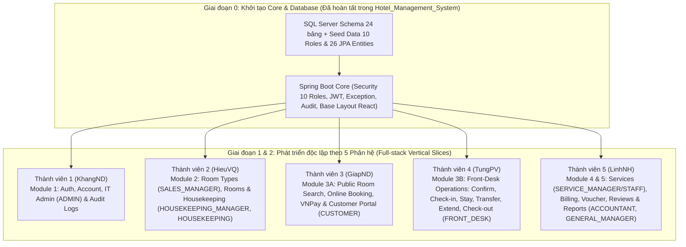

# Phân Tích Tài Liệu SRS & SDD và Chiến Lược Phân Chia Code Nhóm 5 Người (Dự Án HMS)

Tài liệu này tổng hợp kết quả phân tích chi tiết và cập nhật kiến trúc phân quyền **10 Roles chuyên biệt** (theo góp ý của Mentor) cho:
- [HMS_SoftwareRequirementSpecification.docx](./HMS_SoftwareRequirementSpecification.docx) (`HMS-SRS v1.3`)
- [HMS_SoftwareDesignDocument.docx](./HMS_SoftwareDesignDocument.docx) (`HMS_SDD v1.1`)

---

## 1. Tổng Quan Hệ Thống & Kiến Trúc Phân Quyền 10 Roles (Đã Tách Role Manager)

### 1.1 Giải quyết vấn đề "Overloaded Manager Role" theo góp ý của Mentor
Trước đây, role `Manager` bị gộp chung nhiệm vụ của nhiều phòng ban độc lập ngoài thực tế. Dựa trên cấu trúc phòng ban ở **Mục 1.1 của SRS**, hệ thống hiện được tách thành **10 User Roles (Actors con người)** rõ ràng, đảm bảo nguyên tắc **Separation of Duties (SoD)**:

| # | Mã Role (`RoleName` Enum) | Tên Actor trong SRS / SDD | Phòng ban tương ứng (Bảng `Department`) | Phạm vi nghiệp vụ & Use Cases được phép truy cập |
| :-: | :--- | :--- | :--- | :--- |
| 1 | `CUSTOMER` | **Customer** | *Khách hàng bên ngoài* | Đăng ký (`UC-01`), Tìm & Xem phòng (`UC-14, 21, 22`), Đặt phòng & Thanh toán VNPay (`UC-23`), Lịch sử & Hủy đặt phòng (`UC-24, 25`), Gọi dịch vụ phòng (`UC-34, 35`), Đánh giá sau lưu trú (`UC-41, 42`). |
| 2 | `FRONT_DESK` | **Front-Desk Staff** | *Front Office Department* | Xác nhận đặt phòng trực tiếp/chờ duyệt (`UC-26`), Check-in & gán phòng sạch (`UC-27`), Đổi phòng (`UC-28`), Gia hạn (`UC-29`), Check-out (`UC-30`), Lập hóa đơn Folio, áp Voucher, thu tiền & in biên lai (`UC-37..40`), Phản hồi đánh giá (`UC-43`). |
| 3 | `HOUSEKEEPING` | **Housekeeping Staff** | *Housekeeping Department* | Xem danh sách phòng & bảng phân công dọn phòng (`UC-18, 19`), Cập nhật tiến độ vệ sinh (`Dirty` → `Clean` → `Inspected` `UC-19`), Báo cáo hỏng hóc thiết bị (`UC-20`). |
| 4 | `SERVICE_STAFF` | **Service Staff** | *Services & Ancillary Division* | Xem danh mục dịch vụ (`UC-34`), Nhận và hoàn thành đơn dịch vụ phòng, ghi phí vào Folio (`UC-35`), Hủy dịch vụ chưa cung cấp (`UC-36`). |
| 5 | `SALES_MANAGER` | **Sales & Marketing Manager** | *Sales & Marketing Department* | Cấu hình hạng phòng (`UC-11..13`), Cấu hình bảng giá theo thứ (`Room_Type_Price`), Quản lý mã khuyến mãi (`Voucher`), Phản hồi và ẩn/hiện đánh giá khách hàng (`UC-43, 44`), Xem báo cáo công suất phòng (`UC-45`). |
| 6 | `HOUSEKEEPING_MANAGER` | **Housekeeping Manager** | *Housekeeping Department* | Quản lý danh sách phòng vật lý (`UC-15..18`), Phân công nhân viên dọn phòng (`UC-51`), Duyệt và khóa phòng bảo trì (`UC-20`). |
| 7 | `SERVICE_MANAGER` | **Service Manager** | *Services & Ancillary Division* | Tạo mới dịch vụ phụ trợ (`UC-31`), Cập nhật giá dịch vụ (`UC-32`), Ngừng cung cấp dịch vụ (`UC-33`), Phân tích sản lượng tiêu thụ dịch vụ (`UC-47`). |
| 8 | `ACCOUNTANT` | **Accountant** | *Accounting & Finance Department* | Đối soát hóa đơn Folio & thanh toán (`UC-37..40`), Xem báo cáo phân tích doanh thu (`UC-46`), Phân tích doanh thu dịch vụ (`UC-47`), Xuất báo cáo tổng hợp (`UC-50`). |
| 9 | `GENERAL_MANAGER` | **General Manager** | *Executive Management Board* | Giám sát toàn bộ chỉ số vận hành khách sạn: Báo cáo công suất (`UC-45`), Báo cáo doanh thu (`UC-46`), Báo cáo dịch vụ (`UC-47`), Xuất báo cáo tổng hợp (`UC-50`), Tra cứu Operational Audit Logs (`UC-49`). |
| 10 | `ADMIN` | **Administrator** | *IT & Technical Department* | Quản lý tài khoản người dùng (`UC-07`), Khóa/Mở khóa tài khoản & thu hồi token (`UC-08`), Gán Role cho nhân viên (`UC-09`), Cấu hình tham số Audit (`UC-48`) và kiểm tra Security Audit Logs (`UC-49`). |

*(Cùng 2 Actor hệ thống bên ngoài: **11. Payment Gateway - VNPay** và **12. Mail Notification Service - Google SMTP**).*

---

## 2. Kiến Trúc Kỹ Thuật & Quy Ước Chung (SDD v1.1)

- **Frontend (SPA)**: ReactJS 18 (Vite + Pure JavaScript / JSX `.js` & `.jsx`, Functional Components + Hooks — không dùng TypeScript/TSX để khớp 100% chương trình học trên trường), React Router DOM v6, React-Bootstrap + Bootstrap Icons, Axios.
- **Backend (3-Layer REST API)**: Java 21, Spring Boot 3.2.5, Spring Security 6 (Stateless JWT + `@PreAuthorize` theo 10 Roles), Spring Data JPA (Hibernate), Jakarta Validation, Springdoc-OpenAPI (Swagger 3).
- **Database**: Microsoft SQL Server 2019/2022 (**24 bảng nghiệp vụ chính** + 2 bảng hệ thống `Refresh_Token` & `System_Error_Log`).

---

## 3. Chiến Lược Phân Chia Công Việc Cho Nhóm 5 Người

Thiết kế của dự án chia thành **5 Subsystems** (tương ứng từ mục `4.2` đến `4.6` trong SDD và 5 nhóm Use Case trong SRS). Mỗi thành viên phụ trách **1 Phân hệ Full-stack (Vertical Slice)** từ Backend API đến React Page:



### Bảng phân công chi tiết cho 5 thành viên (Cân bằng khối lượng code ~20% mỗi người)

| Thành viên | Phân hệ phụ trách (Full-stack BE + FE) | Các Roles liên quan trực tiếp | Use Cases phụ trách | Bảng DB (Entities) chính sở hữu | Các màn hình (React Pages) chính |
| :--- | :--- | :--- | :--- | :--- | :--- |
| **Thành viên 1**<br/>*(KhangND - Team Lead)* | **Core Security + Module 1: Account, Auth, User Governance & Audit/System Logs** | `All Roles` (Auth), `ADMIN`, `GENERAL_MANAGER` (Audit) | `UC-01` → `UC-10`, `UC-48`, `UC-49`<br/>*(12 UCs + Core)* | `Role`, `Account`, `Customer`, `Staff`, `Department`, `Refresh_Token`, `Audit_Log`, `System_Error_Log` | • Login, Register, Forgot/Reset Password<br/>• User Profile, Change Password<br/>• Admin Dashboard, User Management (List, Detail, Toggle Status, Assign 10 Roles)<br/>• Audit Parameters, Security & Operational Audit Logs |
| **Thành viên 2**<br/>*(HieuVQ)* | **Module 2: Room Types, Physical Inventory, Housekeeping & Maintenance** | `SALES_MANAGER` (Room Type/Price), `HOUSEKEEPING_MANAGER`, `HOUSEKEEPING` | `UC-11` → `UC-13`, `UC-15` → `UC-20`, `UC-51`<br/>*(10 UCs)* | `Room_Type`, `Room_Type_Price`, `Room`, `Housekeeping_Task` | • `SALES_MANAGER`: Room Type CRUD & Pricing theo thứ<br/>• `HOUSEKEEPING_MANAGER`: Room Inventory CRUD & Assign Cleaning Tasks (`UC-51`)<br/>• `HOUSEKEEPING`: Housekeeping Board (`UC-19`), Room Status Details & Maintenance (`UC-20`) |
| **Thành viên 3**<br/>*(GiapND)* | **Module 3A: Public Catalog, Online Booking, VNPay & Customer Portal** | `CUSTOMER`, `FRONT_DESK` | `UC-14`, `UC-21` → `UC-25` + Scheduled Job 24h Hold (`BR-19`)<br/>*(6 UCs lớn + VNPay)* | `Reservation`, `Reservation_Detail`, `Reservation_Nightly_Rate`, `Payment` (Deposit), `Payment_Attempt` | • Public Landing Page, Room List & Search Available Rooms (`UC-14`, `UC-21`), Room Details (`UC-22`)<br/>• Booking Checkout (`UC-23`), Online Payment (VNPay Callback), Booking Confirmation<br/>• Customer: My Bookings, Find Booking, Cancel Booking (`UC-24`, `UC-25`) |
| **Thành viên 4**<br/>*(TungPV)* | **Module 3B: Front-Desk Operations & In-House Stay Management** | `FRONT_DESK` | `UC-26` → `UC-30`<br/>*(5 UCs nghiệp vụ phức tạp nhất)* | `Guest_Stay`, `Stay_Room_Assignment` *(phối hợp `Reservation`, `Room`, `Folio`)* | • Front-Desk Dashboard, Pending Reservations & Confirm Reservation (`UC-26`)<br/>• Direct Reservation Form<br/>• Arrivals List & Guest Check-in Form (`UC-27`)<br/>• Active Stay List & Details, Transfer Room (`UC-28`), Extend Stay (`UC-29`), Check-out (`UC-30`) |
| **Thành viên 5**<br/>*(LinhNH)* | **Module 4 & 5: Services, Folio Billing, Vouchers, Reviews & Analytics Reports** | `SERVICE_MANAGER`, `SERVICE_STAFF`, `SALES_MANAGER` (Voucher/Review), `ACCOUNTANT`, `GENERAL_MANAGER` | `UC-31` → `UC-40`, `UC-41` → `UC-47`, `UC-50`<br/>*(18 UCs)* | `Hotel_Service`, `Service_Order`, `Folio`, `Additional_Charge`, `Voucher`, `Invoice`, `Review` | • `SERVICE_MANAGER`: Services Catalog CRUD (`UC-31..33`)<br/>• `SERVICE_STAFF`: Order & Void Service (`UC-34..36`)<br/>• `FRONT_DESK` / `ACCOUNTANT`: Check-out & Billing, Apply Voucher, Payment, Printable Invoice (`UC-37..40`)<br/>• `SALES_MANAGER`: Voucher CRUD & Review Moderation/Reply (`UC-41..44`)<br/>• `GENERAL_MANAGER` / `ACCOUNTANT`: Reports Dashboard (`UC-45..47, 50`) |

---

## 4. Tổ Chức Cấu Trúc Thư Mục Để Không Đụng Hàng (Merge Conflict)

```text
Hotel_Management_System/
├── .github/
│   └── pull_request_template.md
├── database/
│   ├── V1__init_schema.sql          # 24 bảng nghiệp vụ + 2 bảng hệ thống
│   └── V2__seed_master_data.sql     # Dữ liệu mẫu (10 Roles chuyên biệt, 10 Accounts mẫu, 7 Departments, Rooms, Services, Vouchers)
├── backend/                         # Spring Boot 3 (Java 21)
│   └── src/main/java/com/fpt/hms/
│       ├── config/                  # CORS, OpenAPI, Clock, SecurityConfig
│       ├── security/                # JwtAuthFilter, JwtTokenProvider, UserPrincipal
│       ├── exception/               # GlobalExceptionHandler, BusinessException
│       ├── common/                  # PageResponse, MessageResolver, AuditService, TraceIdFilter
│       ├── enums/                   # RoleName (10 Roles), RoomStatus, CleaningStatus, ReservationStatus...
│       ├── entity/                  # 26 JPA Entities
│       ├── repository/              # 26 Spring Data JPA Repositories
│       ├── dto/
│       │   ├── auth/                # TV1 (KhangND)
│       │   ├── room/                # TV2 (HieuVQ)
│       │   ├── booking/             # TV3 (GiapND)
│       │   ├── frontdesk/           # TV4 (TungPV)
│       │   └── billing_report/      # TV5 (LinhNH)
│       ├── controller/              # Tách riêng theo từng phân hệ
│       ├── service/
│       └── service/impl/
└── frontend/                        # ReactJS 18 (Vite + Pure JavaScript / JSX)
    └── src/
        ├── config/                  # constants.js (10 Roles)
        ├── lib/                     # http.js, datetime.js, money.js
        ├── context/                 # AuthContext.jsx
        ├── components/common/       # RoleGuard.jsx, StatusBadge.jsx, DataTable.jsx, ProtectedRoute.jsx, ToastHost.jsx, ErrorBoundary.jsx
        ├── layouts/                 # CustomerLayout.jsx, StaffLayout.jsx (Sidebar lọc theo đúng 10 Roles)
        ├── router/                  # 5 file route độc lập (.jsx: authRoutes, roomRoutes, bookingRoutes, frontDeskRoutes, billingRoutes)
        ├── services/                # 5 file API độc lập (.js: authApi, roomApi, bookingApi, frontDeskApi, billingApi)
        └── pages/                   # Chia thư mục riêng (.jsx) cho từng thành viên
```
